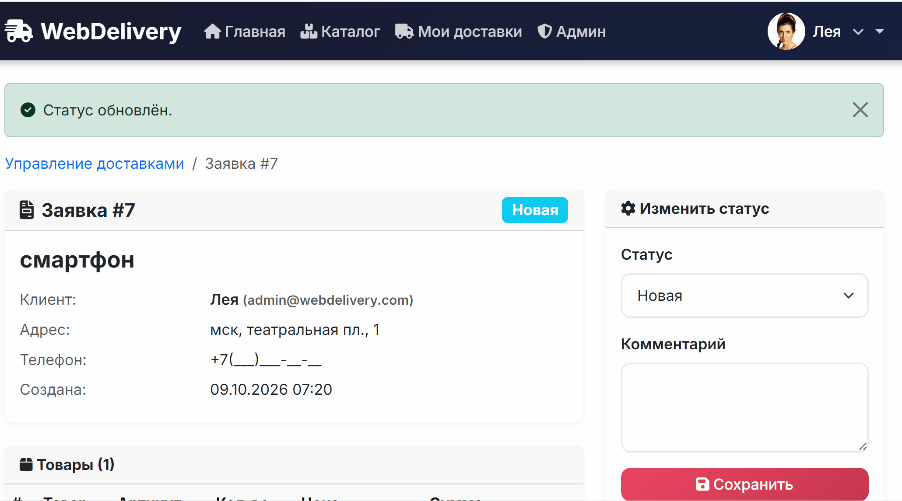
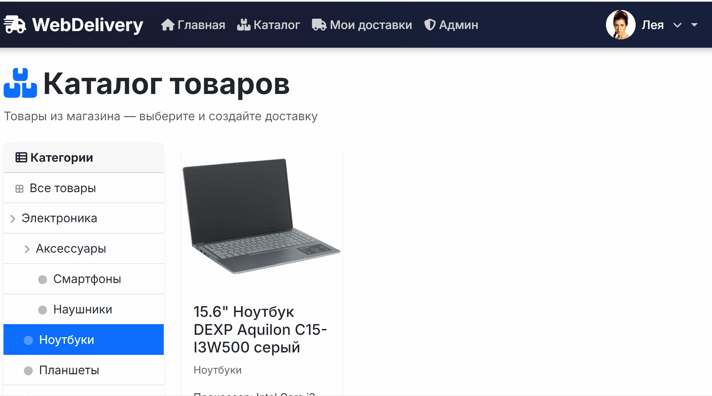

# WebDelivery — Сервис доставки

Веб-приложение для управления доставками товаров из интернет-магазинов.  
Товары заказываются из внешнего магазина (на другом сервере) по REST API.

Презентация доступна по адресу: [Presentation](https://docs.google.com/presentation/d/1VwCl2lf4ZWX46h5Aib2xqQCozENXzq2D3NJptHoE-98/edit?slide=id.p8#slide=id.p8)
https://docs.google.com/presentation/d/1VwCl2lf4ZWX46h5Aib2xqQCozENXzq2D3NJptHoE-98/edit?slide=id.p8#slide=id.p8

#  Подтверждение заявки и списание товара со склада



#  Cоздание заявки на доставку



## Технологии

- **Backend:** PHP 8.3+, Laravel 13
- **Frontend:** Blade, Bootstrap 5, Font Awesome 6
- **Database:** SQLite
- **API:** JWT-авторизация (tymon/jwt-auth)

## Установка

### 1. Клонируйте репозиторий

```bash
git clone <repo-url>
cd webdelivery
```

### 2. Установите зависимости

```bash
composer install
npm install
```

### 3. Настройте окружение

```bash
cp .env.example .env
php artisan key:generate
```

Отредактируйте `.env`:

```env
DB_CONNECTION=sqlite

# URL внешнего магазина (API с товарами) — магазин на порту 8001
SHOP_API_URL=http://localhost:8001
SHOP_API_TOKEN=           # JWT-токен магазина (опционально)
SHOP_API_TIMEOUT=10
```

### 4. Создайте базу данных и выполните миграции

```bash
touch database/database.sqlite
php artisan migrate --force
```

### 5. Заполните тестовыми данными

```bash
php artisan db:seed
```

Создаются:
- **Администратор:** `admin@webdelivery.com` / `admin123`
- **Пользователь:** `user@webdelivery.com` / `user123`
- 3 тестовые заявки на доставку

### 6. Симлинк для аватаров

```bash
php artisan storage:link
```

### 7. Запустите сервер

```bash
php artisan serve
```

Приложение будет доступно по адресу: `http://localhost:8002`

## Роли

| Роль | Описание |
|------|----------|
| `user` | Просмотр каталога, создание/редактирование/удаление своих заявок |
| `admin` | Все действия пользователя + управление всеми заявками, смена статуса |

## Статусы заявок

| Статус | Описание |
|--------|----------|
| `new` | Новая (пользователь может редактировать) |
| `confirmed` | Подтверждена администратором |
| `shipped` | Отправлена |
| `delivered` | Доставлена |
| `cancelled` | Отменена |

## Структура URL

### Web

| Метод | URL | Описание |
|-------|-----|----------|
| GET | `/` | Главная страница |
| GET | `/catalog` | Каталог товаров (из внешнего API) |
| GET | `/catalog/{id}` | Карточка товара |
| GET/POST | `/login` | Авторизация |
| GET/POST | `/register` | Регистрация |
| GET | `/profile` | Личный кабинет |
| GET | `/deliveries` | Мои доставки |
| GET/POST | `/deliveries/create` | Создание доставки |
| GET | `/deliveries/{id}` | Просмотр доставки |
| GET/PUT | `/deliveries/{id}/edit` | Редактирование |
| DELETE | `/deliveries/{id}` | Удаление |
| GET | `/admin/deliveries` | Админ: все заявки |
| GET | `/admin/deliveries/{id}` | Админ: просмотр |
| PATCH | `/admin/deliveries/{id}/status` | Админ: смена статуса |

### API (JWT)

| Метод | URL | Описание |
|-------|-----|----------|
| POST | `/api/auth/login` | Получить JWT-токен |
| POST | `/api/auth/logout` | Выход |
| POST | `/api/auth/refresh` | Обновить токен |
| POST | `/api/auth/me` | Текущий пользователь |
| GET | `/api/deliveries` | Список доставок |
| POST | `/api/deliveries` | Создать доставку |
| GET | `/api/deliveries/{id}` | Просмотр |
| PUT | `/api/deliveries/{id}` | Обновление |
| DELETE | `/api/deliveries/{id}` | Удаление |

## Внешний API магазина

Приложение подключается к внешнему магазину по REST API. Ожидаемый формат:

### GET `/api/categories`

```json
[
  { "id": 1, "title": "Электроника", "slug": "electronics" },
  { "id": 2, "title": "Одежда", "slug": "clothing" }
]
```

### GET `/api/products`

```json
{
  "data": [
    { "id": 1, "title": "iPhone 15", "price": 89990, "image": "...", "quantity": 10 }
  ],
  "current_page": 1,
  "last_page": 1,
  "per_page": 12,
  "total": 1
}
```

### GET `/api/products/{id}`

```json
{
  "data": { "id": 1, "title": "iPhone 15", "price": 89990, "description": "...", "image": "..." }
}
```

## Структура проекта

```
app/
├── Http/
│   ├── Controllers/
│   │   ├── WEB/           # Веб-контроллеры
│   │   │   ├── Admin/     # Админ-панель
│   │   │   └── Auth/      # Авторизация
│   │   └── API/           # REST API
│   └── Middleware/
│       └── CheckIfAdmin.php
├── Models/
│   ├── Delivery.php
│   ├── DeliveryItem.php
│   └── User.php
├── Services/
│   └── ShopApiService.php
└── Providers/
    └── AppServiceProvider.php

resources/views/
├── layouts/main.blade.php
├── home.blade.php
├── catalog/               # Каталог товаров
├── deliveries/            # Заявки на доставку
├── admin/deliveries/      # Админка
└── auth/                  # Авторизация и профиль

database/
├── migrations/
└── seeders/
```

## Лицензия

MIT
